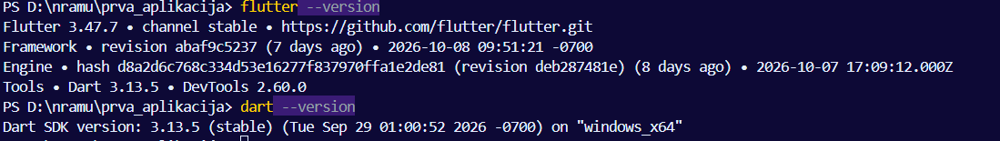

# prva_aplikacija
## Manuela Kurtović

### Operacijski sustav:
 Windows 10 Pro

### Verzije Fluttera i Darta:
Flutter 3.47.7 • channel stable • https://github.com/flutter/flutter.git
Framework • revision abaf9c5237 (7 days ago) • 2026-10-08 09:51:21 -0700
Engine • hash d8a2d6c768c334d53e16277f837970ffa1e2de81 (revision deb287481e) (8 days ago) • 2026-10-07 17:09:12.000Z
Tools • Dart 3.13.5 • DevTools 2.60.0

Dart SDK version: 3.13.5 (stable) (Tue Sep 29 01:00:52 2026 -0700) on "windows_x64"

### Korišteni uređaj:
Na Android Studiu odabran Pixel 10a - Android 17.0

### Provedene izmjene i odgovori na pitanja:
Provjera razumijevanja 1: Skup elemenata sadrži samo dva elementa jer je string 'novo' duplikat, a skup eliminira duplikate. Dohvati za Miju na početku daje 0 jer je korištena provjera '??' pri ispisu kojom se provjeravalo postoje li bodovi za Miju. Na početku bodovi nisu postojali zbog čega je ispisana 0, nakon promjene se ispisuju Mijini bodovi.
.png>)

Provjera razumijevanja 2: Naslov je označen s required sto označava kako se naslov mora unjeti, zadatak ne može postojati bez naslova (naslov mu služi kao id). Svojstvo završen ima zadanu vrijednost false jer je logično da pri samom stvaranju novog zadatka taj zadatak nije još gotov, tek je započet. Ako pokušamo stvoriti zadatak bez naslova taj dio koda će nam bit podcrtan i javit će se greška kako se takav zadatak ne može stvoriti.

Izmjene: 
1. final ime = 'Ana'; je zamijenjeno s final ime = 'Manuela';

2. final teme = <String>['Dart', 'Flutter', 'Git']; na tu listu je dodano final teme = <String>['Dart', 'Flutter', 'Git', 'Programiranje'];

3. final bodovi = <String, int>{'Ana': 80, 'Ivan': 55}; toj mapi je dodana Mia sa 70 bodova final bodovi = <String, int>{'Ana': 80, 'Ivan': 55, 'Mia': 70};

4. Dodavanje zadatka Prvi commit koji je završen: const Zadatak(naslov: 'Prvi commit', zavrsen: true),

5. Funkcija koja vraća naslove otvorenih zadataka: List<String> naslovi(List<Zadatak> zadaci) => zadaci.where((z) => !z.zavrsen).map((z) => z.naslov).toList();
poziv funkcije : print('Otvoreni zadaci:');
for (final n in naslovi(zadaci)) {
print(n);
}

6. Poziv funkcije prikazNapomene:
print(prikazNapomene('Prvi samostalni rad'));
Ispisuje 'Prvi samostalni zadatak'
dok pozivanje s null vrijednosti:
print(prikazNapomene(null));
ispisuje 'Bez napomene'.
Parametar ima tip String? zbog zaštite od null vrijednosti, zatim se provjerava postoji li vrijednost stringa ili ako ne postoji (provjera pomoću ??) prikazuje vrijednost 'Bez napomene'.

7. Unutar main.dart promijenjen je naslov:   title: 'Promijenjen naslov',
 ime i prezime:  Text('Student: Manuela Kurtović'),
 i nadodan je tekst: Text('Želim naučiti bolje programirati u Dart-u ').

Prikaz na android uređaju:  
.png>)